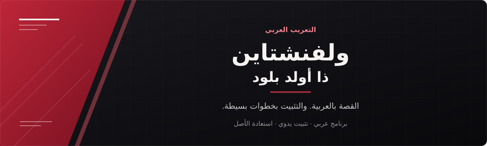
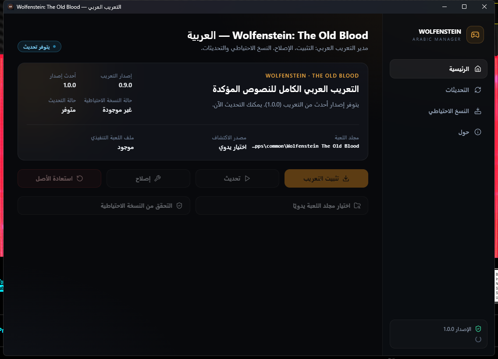

# ولفنشتاين: ذا أولد بلود

**القصة بالعربية. والتثبيت بخطوات بسيطة.**

تعريب مجتمعي غير رسمي لنسخة Steam، مع مدير عربي وخيار تثبيت يدوي.

[**تنزيل البرنامج**](https://github.com/exelight7/WolfensteinTheOldBlood-AR/releases/download/v1.0.1/WolfensteinAR-Manager-1.0.1-x64-setup.exe) · [**تنزيل الحزمة اليدوية**](https://github.com/exelight7/WolfensteinTheOldBlood-AR/releases/download/v1.0.1/WolfensteinAR-Manual-1.0.1.zip)

**الإصدار 1.0.1** · ويندوز 10 / 11 · معمارية 64 بت

[ملاحظات الإصدار](https://github.com/exelight7/WolfensteinTheOldBlood-AR/releases/tag/v1.0.1) · [الإبلاغ عن مشكلة](https://github.com/exelight7/WolfensteinTheOldBlood-AR/issues)

---

## اختر طريقة التثبيت

| البرنامج | الحزمة اليدوية |
| :--- | :--- |
| واجهة عربية لاكتشاف اللعبة والتثبيت والإصلاح والاستعادة. | تشغيل مباشر بأدوات مرفقة، دون تثبيت مدير التعريب. |
| [تنزيل المثبّت](https://github.com/exelight7/WolfensteinTheOldBlood-AR/releases/download/v1.0.1/WolfensteinAR-Manager-1.0.1-x64-setup.exe) | [تنزيل الحزمة المضغوطة](https://github.com/exelight7/WolfensteinTheOldBlood-AR/releases/download/v1.0.1/WolfensteinAR-Manual-1.0.1.zip) |

**يلزم امتلاك اللعبة.** تُبنى ملفات التعريب محليًا من نسختك؛ لا تتضمن الحزمتان أرشيفات اللعبة الأصلية، ولا تحتاجان إلى تثبيت Python.

### عبر البرنامج

1. أغلق اللعبة، ثم نزّل المثبّت وشغّله لتثبيت مدير التعريب.
2. افتح المدير؛ سيكتشف مكتبات Steam. يمكنك أيضًا اختيار مجلد اللعبة الذي يحتوي على `WolfOldBlood_x64.exe`.
3. اضغط **«تثبيت التعريب»**، وانتظر نجاح الفحص والنسخ الاحتياطي والتثبيت، ثم شغّل اللعبة.

### يدويًا

1. أغلق اللعبة وفك الحزمة المضغوطة كاملة في مجلد مستقل.
2. شغّل `Install.cmd` واتبع التعليمات لاختيار مجلد اللعبة. احتفظ بالحزمة والنسخة الاحتياطية.
3. انتظر رسالة النجاح، ثم شغّل اللعبة من Steam.

**للعودة إلى الأصل:** استخدم **«استعادة الأصل»** في البرنامج، أو `Restore.cmd` من الحزمة اليدوية. استعد ملفات اللعبة قبل حذف أدوات التعريب أو نسختها الاحتياطية.

## ما الذي يقدّمه التعريب؟

- قوائم وحوارات وأوصاف بالعربية الفصحى، مع توحيد المصطلحات ومعالجة اتجاه الكتابة واتصال الحروف.
- **3376 سجلًا مترجمًا** من مجموعة موثقة تضم **3574 سجلًا**؛ الباقي **198 مستثنى عمدًا**، مثل القيم الفارغة والمعرّفات التقنية.
- فحص سلامة الملفات قبل التثبيت، ونسخة احتياطية للاستعادة.
- **جديد 1.0.1:** إصلاح فهارس تباعد الحروف في الخطوط العربية الأربعة لمعالجة السبب المكتشف للشقوق بين الحروف. تأكيد النتيجة بصريًا داخل اللعبة ما زال مطلوبًا.

## التوافق

| المتطلب | النسخة المدعومة |
| :--- | :--- |
| النظام | ويندوز 10 أو 11، بمعمارية 64 بت |
| اللعبة | Steam، رقم التطبيق `350080`، البناء `616161` |
| الملفات | مطابقة [بصمات النسخة المدعومة](config/supported_versions.json) |
| البرنامج | Microsoft Edge WebView2 |

قد تمنع التعديلات الأخرى على الملفات نفسها التثبيت. اختر مجلد اللعبة الصحيح، وراجع رسالة الفحص عند ظهور ملفات غير معروفة.

## نظرة على البرنامج

*لقطة فعلية للمدير 1.0.0، تُظهر اكتشاف تعريب سابق. قد تختلف أرقام الإصدار في النسخة الحالية.*

## حدود التغطية

اكتمال مجموعة النصوص الموثقة لا يعني تعريب كل كتابة مرسومة داخل اللعبة. النصوص المدمجة بالصور والفيديو وبعض الواجهات ورسائل المحرك غير معتمدة بالكامل، كما لم يُوثّق اختبار لعب كامل. التفاصيل في [تقرير التغطية](docs/discovery/TEXT_COVERAGE.md).

عند الإبلاغ عن مشكلة، أرفق مكان ظهورها ولقطة وإصدار التعريب؛ لا ترفق ملفات اللعبة. المثبّت غير موقّع رقميًا؛ استخدم تنزيلات هذا المستودع دون تعطيل حماية ويندوز.

## الحقوق والمساهمة

إعداد وتطوير [exelight7](https://github.com/exelight7) والمساهمين. المشروع غير تابع إلى MachineGames أو Bethesda؛ حقوق اللعبة وعلاماتها لأصحابها.

الكود بترخيص [MIT](LICENSE)، وترخيص بيانات الترجمة العربية لم يُحسم بعد. الخط **IBM Plex Sans Arabic** بترخيص [SIL OFL](licenses/IBM_Plex_OFL.txt).

[دليل المساهمة](CONTRIBUTING.md) · [توثيق البرنامج](app/README.md) · [إشعارات الأطراف الثالثة](THIRD_PARTY_NOTICES.md) · [سياسة الأمان](SECURITY.md) · [القرارات](DECISIONS.md)
